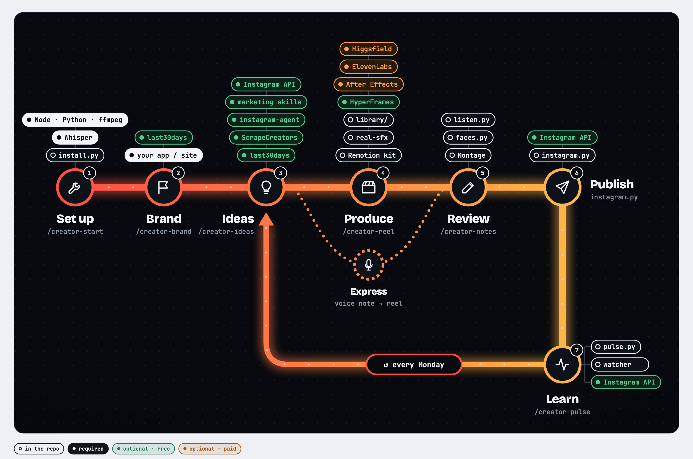

<p align="center">
  <picture>
    <source media="(prefers-color-scheme: dark)" srcset="docs/logo-dark.png">
    
  </picture>
</p>

# Creator OS

**by Dirac Core** · **Your AI content team for growing on social media.** An open system for Claude Code, Codex, Gemini or Grok: it decides what to post, produces reels at editor quality and learns from your metrics.

A system so your AI helps you **grow on social media**: decide what to post, produce reels at editor quality (voice-based cuts, word-by-word captions, motion graphics, measured sound), test variations and learn from your own metrics. It is built to work **in stages, with your approval at each one**: the AI prepares, you decide.

It works with agents that read and edit files and run commands on your computer: **Claude Code**, **Codex CLI** (ChatGPT), **Gemini CLI**, **Grok CLI** or any other that reads `AGENTS.md`. With a chat-only AI (ChatGPT or Claude in the browser) it works as a guide, but it can't produce the videos.

**Use it in your language.** The repo is in English, but the AI talks to you, asks you things and walks you through every setup step (logins, connections, approvals) in whatever language you write to it in.




**Interactive map** (English / Español): open **[diraccore.com/creator-os](https://diraccore.com/creator-os)**, or download [`docs/guide.html`](docs/guide.html) and open it in your browser. It plays a short tour on its own: each stop, what it uses and what you approve. Tap any stop to see it up close.

## What's inside

| Command (skill) | What it's for |
|---|---|
| `/creator-start` | The first time: checks your computer, tells you what's required and what's optional, and sets it up step by step |
| `/creator-brand` | Create or edit a brand: its real niche (from your product's repo or website), its tone and its content wheel |
| `/creator-ideas` | What to post: researches what's trending in your niche this week and crosses it with your metrics. It proposes ideas by network and format (reel, story, carousel) and you iterate together |
| `/creator-reel` | Produce a reel in stages: script, voice cut, voice, visual script, animation (Remotion), sound, review and variations. It has an **express mode** for the daily reel from a voice note |
| `/creator-pulse` | How it's going: metrics for everything you've posted (stories too), the card for each reel and your **own style**, drawn from what worked |
| `/creator-notes`, `/creator-montage` | Review in **Montage**, the repo's local editor: you draw on the frame, write the note and the AI fixes it |

Python and Node tools live in `production/tools/`. Among others:
- a voice cut that never splits a word;
- local transcription (Whisper);
- variations with 540p drafts;
- automatic check that nothing covers the face, and an automatic cover;
- posting through the official Instagram API;
- the metrics watcher.

## Getting started

**In Claude Code, the plugin is the fastest way.** Paste this into Claude Code:

```
/plugin marketplace add CamiloRincon96/creator-os
/plugin install creator-os@creator-os
```

Then type **`/creator-os:start`**. It asks where to put the folder, clones the repo with your yes and opens the way to `/creator-start`.

**With any other agent (or if you'd rather do it by hand):**

1. Clone this repo and open it with your agent (for example, `claude` in the folder).
2. Type **`/creator-start`**, or ask it to "read `GETTING-STARTED.md` and walk me through it". It takes you step by step.
3. Create your brand with **`/creator-brand`** and plan the week with **`/creator-ideas`**.

**You don't need to know how to code.** Ask your AI to walk you through the installation and to explain what each command does before it runs it. The skills come with the repo: in Claude Code they show up as the `/creator-…` commands, and Codex, Gemini and Grok find them through `AGENTS.md`. Nothing gets installed or paid for without your yes.

What's required and what's optional, in detail: [`GETTING-STARTED.md`](GETTING-STARTED.md). The folder map: [`MAP.md`](MAP.md).

## Montage, the review editor

Every video, image or carousel the AI makes lands in Montage as a new version (`/creator-montage`). It runs on your computer: nothing gets uploaded anywhere.

**1. Point at the exact frame.** Pause, draw a box, arrow or pin over what you want changed, pick the kind (change, add, remove, fix, idea) and write it. *Send to Claude* sends all your notes at once.


**2. The AI answers with a new version.** Type `/creator-notes` in your AI: it takes each change one by one, replies to the note with its plan, makes it and publishes v2, marking what it fixed. You approve or reopen. The star marks the FINAL, and only you can mark it.


**3. See it on every network.** The same piece inside Reels, TikTok, Shorts, Stories, the feed and the profile grid, so you see what gets covered and cropped before posting.


## Principles

- **Every stage ends in something you see or hear and approve.** Nothing is posted without your explicit approval.
- **The AI can't hear:** sound is measured (LUFS, intelligibility) and you approve it by ear.
- **Nothing paid without a quote.** After Effects, Higgsfield and ElevenLabs are optional and are never used without asking you.
- **Keys and tokens never go in the repo or in the chat.** They go in your system keychain or in environment variables.
- **Music only with a verified license:** CC0 with its credit. Commercial songs never go inside the file.
- What goes wrong is written down in `production/LESSONS.md` so it doesn't happen again.

## License

MIT (see `LICENSE`). The sounds in `brands/example/sounds/` are CC0 and come with their credits. Remotion has its own license: it is free for individuals and for companies of up to 3 employees ([terms](https://www.remotion.dev/license)).

## Found it useful?

We'd appreciate your ⭐ on GitHub, the like of repos: it helps more creators find Creator OS.

**[Star Creator OS on GitHub](https://github.com/CamiloRincon96/creator-os)** · by Dirac Core
