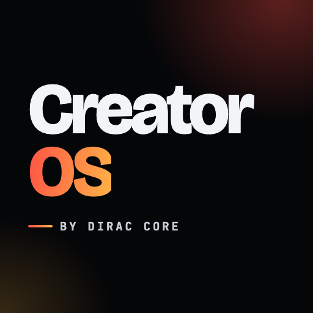

# Creator OS

Creator OS by Dirac Core is a content studio that runs inside Claude Code, for one brand or many (an agency's clients, your own products, your personal account). It finds each brand's real niche, proposes hooks backed by what that niche is sharing this month, produces reels with motion graphics and real recorded sound, lets you review them on the exact frame in a local editor, schedules Instagram trial reels and reads the metrics every Monday. You approve every stage.

This plugin adds one command, `/creator-os:start`. It sets up the Creator OS workspace on your computer and hands over to `/creator-start`, which walks you through the rest.

## Install

Inside Claude Code:

```
/plugin marketplace add CamiloRincon96/creator-os
/plugin install creator-os@creator-os
```

Then type `/creator-os:start`, or just ask: "set up Creator OS".

## What it runs, fetches and sends

- **One download, with your yes:** `git clone` of the public repo (github.com/CamiloRincon96/creator-os, about 20 MB) into a folder you choose. It never clones into a folder that already has files.
- **Git, only if it's missing and only with your yes:** the plugin gives you the install command for your system before running it.
- **Nothing is sent anywhere.** The plugin has no hooks, no MCP servers, no background processes and no telemetry.

After that, the workspace's own `/creator-start` checks your computer and installs the requirements (Node, Python, ffmpeg, a local Whisper model) one question at a time. The optional connections are explained before you turn them on: the Instagram API, last30days research, After Effects, ElevenLabs and Higgsfield. The last three are paid tools and are never used without a quote you approved. The full list is in the repo's `GETTING-STARTED.md`.

## Requirements

Claude Code on your computer (macOS, Windows or Linux), git and about 6 GB of disk. In a claude.ai chat alone it can only explain the system: making the videos needs an agent that runs commands on your computer.

## License

MIT. If it saves you a week of work, star the repo on GitHub. That's the whole payment.
